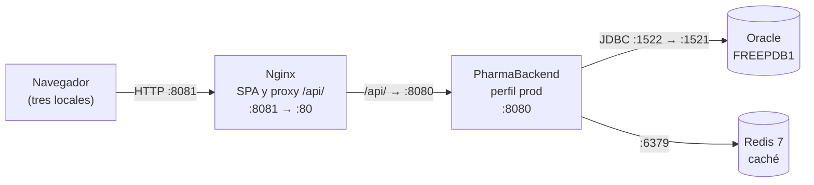

# PharmaFrontend

This project was generated using [Angular CLI](https://github.com/angular/angular-cli) version 22.2.0.

## Development server

To start a local development server, run:

```bash
ng serve
```

Once the server is running, open your browser and navigate to `http://localhost:4200/`. The application will automatically reload whenever you modify any of the source files.

## Code scaffolding

Angular CLI includes powerful code scaffolding tools. To generate a new component, run:

```bash
ng generate component component-name
```

For a complete list of available schematics (such as `components`, `directives`, or `pipes`), run:

```bash
ng generate --help
```

## Building

To build the project run:

```bash
ng build
```

This will compile your project and store the build artifacts in the `dist/` directory. By default, the production build optimizes your application for performance and speed.

## Running unit tests

To execute unit tests with the [Vitest](https://vitest.dev/) test runner, use the following command:

```bash
ng test
```

## Running end-to-end tests

For end-to-end (e2e) testing, run:

```bash
ng e2e
```

Angular CLI does not come with an end-to-end testing framework by default. You can choose one that suits your needs.

## Additional Resources

For more information on using the Angular CLI, including detailed command references, visit the [Angular CLI Overview and Command Reference](https://angular.dev/tools/cli) page.

## Despliegue en producción

### Arquitectura y puertos



La SPA y el API se sirven desde el mismo origen, así que no hace falta CORS. La URL del API es relativa (`/api/v1`) en `environment.ts`.

### Variables de entorno

La SPA no lee variables en tiempo de ejecución: la configuración se fija al compilar. Las del backend (`DB_URL`, `DB_USERNAME`, `DB_PASSWORD`, `JWT_SECRET`, `FRONTEND_ORIGINS` y otras) están en el README de [PharmaBackend](https://github.com/Legends600/TareaS1). Nginx y Redis usan los valores de `deploy/`, sin secretos.

### Construir y desplegar

```bash
npm ci
ng build
cd deploy
docker compose up -d
docker compose ps
```

`ng build` usa la configuración de producción y genera `dist/pharma-frontend/browser`, que Nginx monta como solo lectura. No hace falta detener Nginx: los archivos nuevos llevan otro hash y `index.html` siempre se revalida, de modo que el usuario recibe la versión nueva al recargar sin borrar la caché.

Si la carpeta `dist` se borra y se vuelve a crear, compruebe que Nginx sigue sirviendo la versión nueva.

### Volver a la versión anterior

Guarde cada compilación con su commit, fuera del repositorio (por ejemplo, `../releases/<commit>/`). Para volver:

1. Copie esa compilación sobre `dist/pharma-frontend/browser`.
2. Recargue la página: `index.html` apunta otra vez a los archivos anteriores.

También puede recompilar el commit anterior con `git checkout <commit> && ng build`, porque el mismo código produce los mismos nombres de archivo.

### Estado de las buenas prácticas

| Buena práctica | Estado | Acción pendiente |
|---|---|---|
| Carga diferida de cada feature | Cumple | Ninguna |
| División de código con `@defer` | Cumple | Ninguna |
| Layout fuera del paquete inicial | Cumple | Ninguna |
| Precarga de módulos | Cumple parcialmente | `PreloadAllModules` también descarga módulos que el rol no usa (código, no datos); evaluar una estrategia por permiso |
| Presupuestos de tamaño activos | Cumple | Ninguna |
| Archivos con hash y caché de un año; `index.html` sin caché | Cumple | Ninguna |
| Compresión | Cumple parcialmente | gzip activo; evaluar Brotli |
| Ruta directa (F5) sin 404 | Cumple | Ninguna |
| Código de seguimiento en los errores | Cumple | Ninguna |
| HTTPS | No cumple | Certificado en Nginx |
| Encabezados de seguridad en Nginx (CSP, HSTS) | No cumple | Añadirlos junto con HTTPS |
| Pruebas de extremo a extremo automatizadas | No cumple | Se trabajan en la siguiente sesión |

### Recomendaciones para los tres locales

1. **HTTPS en Nginx (prioridad alta).** El token y la contraseña viajan por la red de cada local y entre locales. Sin cifrado, cualquiera en esa red puede leerlos.
2. **Un solo despliegue central con copias de seguridad de Oracle (prioridad alta).** Los tres locales deben ver el mismo stock. Con el Redis y el Oracle centrales, una venta en un local invalida la caché para todos.
3. **Alertas sobre `/actuator/health` (prioridad media).** Sondear cada minuto y avisar a soporte. El vendedor puede dictar el código de seguimiento que muestra la SPA para que soporte localice la petición en el log.
